  

### Hi there! 👋

I'm [**Krum**](https://krumqnkata.github.io), a student developer from Stara Zagora, Bulgaria. I build web apps, desktop tools, small games and things for my 3D printer, from the interface and API all the way to the server.

Lately I've been working on [**Extruda**](https://krumqnkata.github.io/extruda/), a 3D-print workshop in the browser, a [**school platform**](https://pgknma.space) with React and Django, and a [**noise meter**](https://github.com/Krumqnkata/noise-measure-tool) that recognises sounds with machine learning. Everything else, with screenshots and live demos, is on my **[portfolio →](https://krumqnkata.github.io)**

Outside of code I tinker with Arduino and RFID, 3D print a lot and edit audio.

#### Let's connect!

<picture>
  <source media="(prefers-color-scheme: dark)" srcset="https://raw.githubusercontent.com/Krumqnkata/Krumqnkata/main/assets/generated/snake-dark.svg">
  
</picture>
