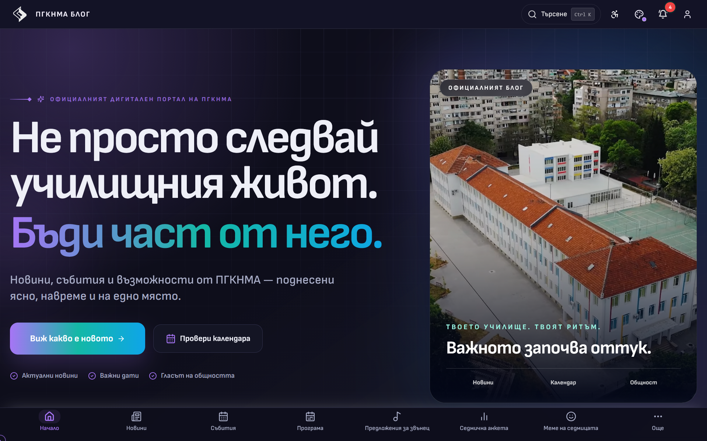
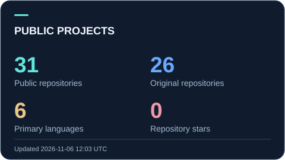
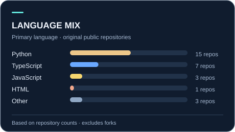

<!-- Visual assets live in this repository. Public statistics and the snake refresh through GitHub Actions. -->

  

  <a href="https://krumqnkata.github.io"><b>🌐 Portfolio — all my projects</b></a> &nbsp; · &nbsp;
  <a href="https://krumqnkata.github.io/bg/">На български</a> &nbsp; · &nbsp;
  <a href="mailto:krumidanikrumov@abv.bg">Email</a>

Hi, I'm **Krum**, a student developer from **Stara Zagora, Bulgaria**, studying at **PGKNMA “Prof. Minko Balkanski”**. I build school platforms, desktop tools and practical services with **Python, Java, web technologies and Linux**, from the interface and API through to deployment.

## Selected projects

<table>
<tr>
<td colspan="2" valign="top">
<h3><a href="https://krumqnkata.github.io/projects/pgknma-blog/">PGKNMA Blog — School Digital Platform</a></h3>

Articles, events, polls, profiles and notifications for my school. React + TypeScript frontend, Django REST API, MySQL and Web Push. Open source under AGPL-3.0, built with <a href="https://github.com/ythef0">ythef0</a> and <a href="https://github.com/lkbonev72">lkbonev72</a>.

<b><a href="https://pgknma.space">Website</a> · <a href="https://github.com/Krumqnkata/PGKNMA-Blog">Frontend</a> · <a href="https://github.com/Krumqnkata/pgknma-blog-backend">Backend</a> · <a href="https://krumqnkata.github.io/projects/pgknma-blog/">Technical overview</a></b>

</td>
</tr>
<tr>
<td width="50%" valign="top">
<h3><a href="https://krumqnkata.github.io/projects/extruda/">Extruda — 3D Print Workshop</a></h3>

Keychains, SVG logos, Gridfinity, boxes, cookie cutters and lithophanes, generated in the browser. STL/3MF, works offline.

<b>TypeScript · Three.js · PWA</b>

<b><a href="https://krumqnkata.github.io/extruda/">Open the app</a> · <a href="https://github.com/Krumqnkata/extruda">Code</a></b>

</td>
<td width="50%" valign="top">
<h3><a href="https://krumqnkata.github.io/projects/noise-measure-tool/">Noise Meter</a></h3>

A real-time sound level meter in the browser with YAMNet sound recognition, spectrum, noise dose and EU/Bulgarian norms.

<b>Python · FastAPI · WebSocket · YAMNet</b>

<b><a href="https://github.com/Krumqnkata/noise-measure-tool">Code</a> · <a href="https://krumqnkata.github.io/projects/noise-measure-tool/">Details</a></b>

</td>
</tr>
</table>

  <a href="https://krumqnkata.github.io/#projects"><b>See all projects with screenshots, live demos and READMEs →</b></a>

## Toolkit

  
  
  
  
  
  
  
  
  
  
  
  

## GitHub activity

  
  

  <picture>
    <source media="(prefers-color-scheme: dark)" srcset="https://raw.githubusercontent.com/Krumqnkata/Krumqnkata/main/assets/generated/snake-dark.svg">
    <source media="(prefers-color-scheme: light)" srcset="https://raw.githubusercontent.com/Krumqnkata/Krumqnkata/main/assets/generated/snake-light.svg">
    
  </picture>

<b>🇧🇬 На български</b>

 

Здравей, аз съм **Крум** — ученик в **ПГКНМА „Проф. Минко Балкански“, Стара Загора**. Правя училищни платформи, настолни приложения и автоматизации с **Python, Java, уеб технологии и Linux**. Всички проекти със снимки и описания на български има в **[портфолиото ми](https://krumqnkata.github.io/bg/)**.

**Контакт:** [krumidanikrumov@abv.bg](mailto:krumidanikrumov@abv.bg)

---

  Кодът е началото. Ползата му дава смисъл.

